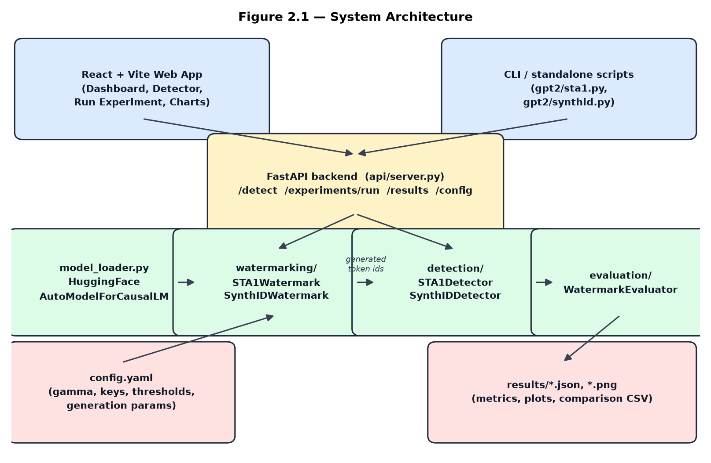
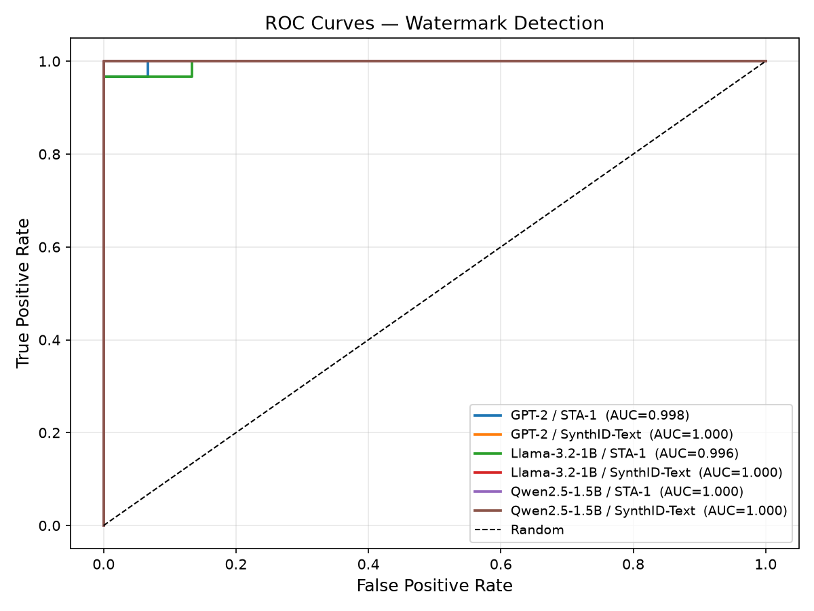

# LLM Watermarking

Embed and detect statistical watermarks in text generated by large language models.
The project implements two **distortion-free** watermarking schemes, evaluates them
across several open causal LMs, and ships a FastAPI backend plus a React web app
for running experiments and checking text interactively.

| Algorithm | Idea | Reference |
|---|---|---|
| **STA-1** (Sampling One Then Accepting) | Rejection sampling against a hashed green list — the model's logits are never modified | Variant of the KGW green/red-list scheme (Kirchenbauer et al., 2023) |
| **SynthID-Text** | Tournament sampling: draw several candidates, keep the one with the highest keyed hash score | Dathathri et al., *Nature* 2024 (Google DeepMind) |



## How it works

### STA-1

At each generation step *t*:

1. Hash the previous token `x_{t-1}` with a global seed (SHA-256 → NumPy shuffle) to
   pick a **green list** of `⌊γ·|V|⌋` vocabulary tokens.
2. Sample a candidate from the **unmodified** model distribution.
3. If it is green, emit it; otherwise reject and resample (up to `max_attempts`),
   falling back to the last candidate to protect fluency.

**Detection** counts green tokens over `T` tokens and applies a one-sided z-test:

```
z = (green_count − γ·T) / √(T·γ·(1−γ))
```

### SynthID-Text

With secret keys `k_0 … k_{D-1}` shared by generator and detector, at each step:

1. Sample `B` candidate tokens i.i.d. from the base distribution.
2. Score each candidate: `score(c) = (1/D) Σ_d g(k_d, x_{t-d-1}, c)`, where `g` hashes
   to a float in `[0, 1]`.
3. Emit the highest-scoring candidate.

Watermarked text has mean g-values skewed above 0.5; **detection** turns the
normalised mean g-value into a z-score on the same scale as STA-1.

Both detectors flag text as watermarked when `z ≥ 4.0` (one-sided FPR ≈ 3×10⁻⁵).

## Results

Evaluated on 30 prompts per model (200 new tokens, temperature 1.0, threshold z = 4.0,
run on Apple MPS). Every generation was scored by both detectors; unwatermarked
continuations of the same prompts were used as negatives.

| Model | Algorithm | TPR | FPR | Accuracy | F1 | AUC-ROC | Mean z (wm / plain) |
|---|---|---|---|---|---|---|---|
| GPT-2 (124M) | STA-1 | 0.967 | 0.0 | 0.983 | 0.983 | 0.998 | 11.69 / −0.26 |
| GPT-2 (124M) | SynthID-Text | 1.000 | 0.0 | 1.000 | 1.000 | 1.000 | 7.91 / −0.06 |
| Llama-3.2-1B | STA-1 | 0.967 | 0.0 | 0.983 | 0.983 | 0.996 | 12.76 / 0.02 |
| Llama-3.2-1B | SynthID-Text | 1.000 | 0.0 | 1.000 | 1.000 | 1.000 | 8.07 / −0.06 |
| Qwen2.5-1.5B | STA-1 | 0.967 | 0.0 | 0.983 | 0.983 | 1.000 | 11.99 / −0.37 |
| Qwen2.5-1.5B | SynthID-Text | 0.933 | 0.0 | 0.967 | 0.966 | 1.000 | 7.34 / −0.15 |

Key takeaways:

- **No false positives** for either scheme on any model.
- STA-1 produces larger z-scores; SynthID-Text gives tighter, more consistent separation
  (AUC-ROC = 1.0 on all three models).
- The watermarks are **key-specific**: the STA-1 detector on SynthID text (and vice versa)
  scores z ≈ 0.

Raw data is in [`report/results/`](report/results/) and plots in
[`report/figures/`](report/figures/) (ROC curves, score distributions, z-score by model).
This work was developed as a Semester 3 project; the full project report is available on request.



## Repository layout

```
├── src/                     Core library
│   ├── watermarking/        STA1Watermark, SynthIDWatermark (+ BaseWatermark)
│   ├── detection/           STA1Detector, SynthIDDetector (+ BaseDetector)
│   ├── models/              ModelLoader and SUPPORTED_MODELS aliases
│   └── evaluation/          WatermarkEvaluator — TPR/FPR/F1/AUC-ROC and plots
├── api/server.py            FastAPI backend for the web app
├── webapp/                  React + TypeScript + Vite front end ("Watermark Lab")
├── gpt2/, opt_125m/         Self-contained single-file demos per model × algorithm
├── report/                  Evaluation harness, figures, results and report builder
├── config.yaml              Models, watermark hyper-parameters, thresholds
└── requirements.txt
```

## Getting started

Requires Python 3.10+ and (for the web app) Node.js 18+.

```bash
python -m venv venv
source venv/bin/activate          # Windows: .\venv\Scripts\Activate.ps1
pip install -r requirements.txt
```

Model weights are downloaded from Hugging Face on first use. `meta-llama/Llama-3.2-*`
is gated — accept the licence on Hugging Face and run `huggingface-cli login` first.
GPT-2, OPT and Qwen need no authentication.

### Quick demos

Each script is standalone (no dependency on `src/`) and prints the generated text
with its detection score:

```bash
python gpt2/sta1.py
python gpt2/synthid.py
python opt_125m/sta1.py
python opt_125m/synthid.py
```

### Using the library

```python
from src.models.model_loader import ModelLoader
from src.watermarking.sta1_watermark import STA1Watermark
from src.detection.sta1_detector import STA1Detector
```

See [`report/run_evaluation.py`](report/run_evaluation.py) for a complete
generate → detect → evaluate pipeline built on these classes.

### Reproducing the evaluation

```bash
python report/run_evaluation.py                       # all models
python report/run_evaluation.py GPT-2 Qwen2.5-1.5B    # subset (others reused from disk)
python report/run_evaluation.py --reuse               # recompute metrics + figures only
python report/make_diagram.py                         # architecture diagram
```

`run_evaluation.py` sets `HF_HUB_OFFLINE=1`, so download the model weights once
beforehand (or unset that variable).

## Web app

The FastAPI backend and the React front end together form **Watermark Lab**:

- **Dashboard** — summary of the latest results
- **Run experiment** — generate a plain and a watermarked continuation side by side,
  with z-score, p-value and verdict (GPT-2, Qwen2.5-1.5B or Qwen2.5-3B)
- **Detector** — paste any text and score it with both detectors
- **Charts** — visualise evaluation results

```bash
# Terminal 1 — API on http://localhost:8000
python -m uvicorn api.server:app --reload --port 8000

# Terminal 2 — UI on http://localhost:5173
cd webapp && npm install && npm run dev
```

API endpoints:

| Method | Path | Purpose |
|---|---|---|
| GET | `/api/health` | Health check |
| POST | `/api/detect` | `{ "text": "..." }` → token count and STA-1 / SynthID z-scores |
| POST | `/api/experiments/run` | `{ model, algorithm, prompt, max_new_tokens, temperature }` → plain vs. watermarked result |
| GET | `/api/results` | Latest `results/results_*.json` |
| GET | `/api/config` | Current watermark configuration (secret keys omitted) |

See [`webapp/README.md`](webapp/README.md) for more detail.

## Configuration

[`config.yaml`](config.yaml) controls the models, hyper-parameters and thresholds:

| Key | Default | Meaning |
|---|---|---|
| `watermarking.sta1.seed` | 42 | Seed for green-list partitioning |
| `watermarking.sta1.gamma` | 0.5 | Fraction of vocabulary in the green list |
| `watermarking.synthid.keys` | `[2024, 42, 1234, 5678]` | Secret keys, one per context depth |
| `watermarking.synthid.n_candidates` | 5 | Tournament size B |
| `generation.max_new_tokens` | 200 | Tokens generated per prompt |
| `generation.temperature` | 1.0 | Sampling temperature |
| `detection.*.z_threshold` | 4.0 | Detection threshold |

Model names can be any Hugging Face id or a short alias from `SUPPORTED_MODELS` in
[`src/models/model_loader.py`](src/models/model_loader.py) (e.g. `gpt2`, `opt-1.3b`,
`tinyllama`, `phi-2`, `qwen-2.5-1.5b`).

> The keys and seed in this repository are for demonstration only. In a real
> deployment they must be kept secret — anyone who has them can both detect and forge
> the watermark.

## References

- J. Kirchenbauer et al., "A Watermark for Large Language Models," ICML 2023.
- S. Dathathri et al., "Scalable watermarking for identifying large language model
  outputs," *Nature* 634, 2024. https://www.nature.com/articles/s41586-024-08025-4

## License

Released under the [MIT License](LICENSE).
